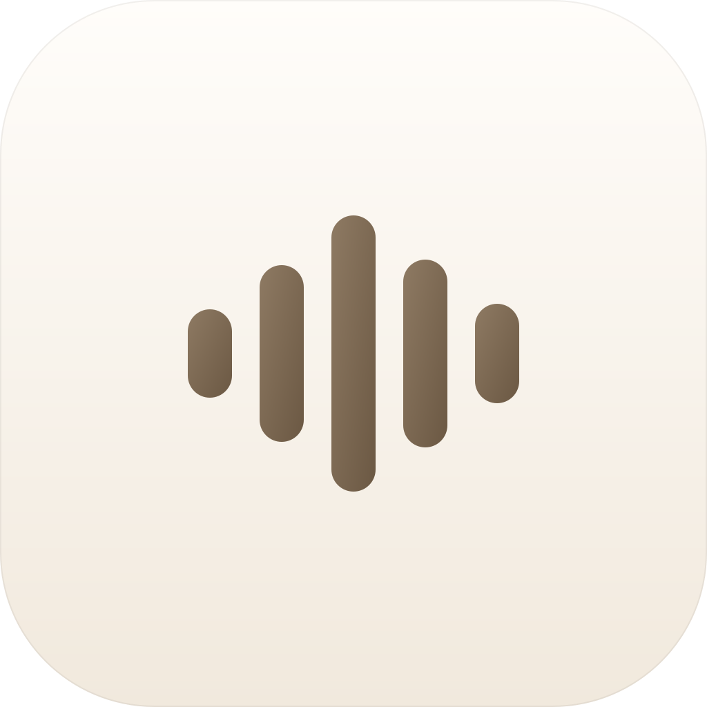

# sotto

AI Passport 的 macOS 桌面客户端（MyGo 原生 UI）。

按住设备按键说话 → BLE 上传 IMA ADPCM 音频 → 火山 v3 流式 ASR → 候选字悬浮窗 →
松手注入当前输入框。链路与固件零改动兼容，协议逐字节对齐官方实现。

- 固件与官方 Python 客户端：<https://github.com/zhaohuaxiaoy/folo-ai-passport-voice>



## 状态

| 阶段 | 状态 |
|---|---|
| M0 BLE 闸门（扫描/连接/配对/订阅/校时） | ✅ 真机通过 |
| M1 音频重组 + ADPCM + 火山 ASR | ✅ 代码完成（`cmd/probe` 可验） |
| M3 UI：主窗 / 设置 / 托盘 / 悬浮窗 / 诊断 | ✅ 本次落地 |
| M2 闭环：说话 → 悬浮窗 → 定稿注入 → 设备 DONE | ✅ 真机通过（`internal/session`，有单测） |
| 可靠性：自动重连、每小时校时、注入落地校验 | ✅ 本次落地 |
| 识别调优：热词 / 对话上下文 / 静音判停 / 语义顺滑 | ✅ 本次落地 |
| 审批（设备端物理确认） | ⛔ 不做（用户明确不需要；协议层保留，随时可接） |
| 首启向导 | ⏳ 未做（单页表单 + 测试按钮已等价可用） |

## 跑应用

```sh
make dev     # = CGO_ENABLED=1 go tool mygo dev
make build   # = CGO_ENABLED=1 go tool mygo build → build/darwin-amd64/Sotto.app + dmg
```

打包产物是 **ad-hoc 签名**（本机没有 Developer ID）：
- 本机运行没问题（不是从网络下载，没有 quarantine 标记）
- 公证（notarize）做不了，`make build` 会跳过并提示
- ad-hoc 每次重建 cdhash 都会变，**蓝牙/辅助功能授权可能重新弹窗**；要避免就买 Developer ID 或固定一个签名身份

> **`CGO_ENABLED=1` 不能省**。mygo CLI 在 `CGO_ENABLED` 未设置时会强制传
> `CGO_ENABLED=0`（`cmd/mygo/proc.go`），而 BLE 走的是 cbgo（cgo 包）。cgo 一关，
> cbgo 里 `import "C"` 的文件全被排除，只剩接口定义，报错会是
> `undefined: CentralManager` / `undefined: Peripheral` —— 与真实原因无关。
> 另外 `go env -w CGO_ENABLED=1` 也救不了：CLI 会显式覆盖子进程环境。

界面里可以做的：

- **设备**：改广播名、连接/断开、启动时自动连接。连接成功状态点变绿，日志里能看到
  `校时成功 → 链路已加密，配对 OK`。
- **语音识别**：粘贴火山 API Key（输入框是密码模式）、切资源 ID（1.0 / 2.0）、
  改端点与模型、"测试连接"零音频握手验证 Key。
- **输入注入**：自动 / 键盘事件 / 剪贴板；改测试文本后点"试注入"直接把字打进当前
  焦点输入框，"检查授权"报告辅助功能权限。
- **识别调优**（设置页）：热词（人名/项目名/命令）、对话上下文（`dialog_ctx`，
  按 user/bot 交替）、静音判停 `end_window_size`（快 0.5s / 默认 0.8s / 耐等 1.5s）、
  语义顺滑 `enable_ddc`（删停顿词）；都随首帧下发，改完下一次说话即生效。
- **候选字悬浮窗**：开关 + 预览（底部居中、不抢焦点；高度按文本实测向上生长）。
- **断线自动重连**：1s→2s→4s…（上限 30s）退避，手动断开即停。
- **每小时校时**：连接后每小时一次 `time.set`。
- **日志 / 诊断**：最近日志、一键复制、诊断页（配置路径、授权状态、连接状态）。
- **设备按键**：长按时设备发来的 `key.action` 已经接通 —— 回车/清空真的会注入。
- **托盘**：连接状态、连接/断开、预览悬浮窗、测试注入、打开主窗、退出。

设置存在 `~/Library/Application Support/sotto/config.json`（sotto 自己的目录，
不碰官方客户端的 `AI Passport` 目录）。

## 跨平台与 CI

| 平台 | BLE 实现 | cgo | 产物 |
|---|---|---|---|
| macOS Intel (amd64) | cbgo → CoreBluetooth | **需要** (`CGO_ENABLED=1`) | `sotto-<ver>-amd64.dmg` |
| macOS Apple Silicon (arm64) | 同上 | **需要** | `sotto-<ver>-arm64.dmg` |
| Windows (amd64) | `tinygo.org/x/bluetooth` → WinRT（纯 syscall，**未真机验证**） | 不需要 | `Sotto.exe` + `sotto-<ver>-setup-amd64.exe` |
| Linux | 无（编译通过，运行时提示不支持 BLE） | 不需要 | — |

CI 见 `.github/workflows/build.yml`：

- cgo 不能可靠交叉编译，所以 **amd64 用 `macos-13`（Intel）、arm64 用 `macos-14`（Apple Silicon）各建各的**
- 两份 dmg 分别覆盖 Intel 与 M 系列（M 上也能用 amd64 走 Rosetta）
- 打 `v*` tag 会自动建 Release 并附上三种产物
- 没有 Developer ID，构建走 ad-hoc 签名 + `-skip-notarize`

## 手工验注入（不需要设备）

```sh
go run ./cmd/injectcheck -probe      # 只探测：前台 app / 聚焦元素 role / 字数
go run ./cmd/injectcheck            # 注入默认文本，并报告"字数有没有变"
go run ./cmd/injectcheck -mode clipboard
```

要点：只有 `role` 是 `AXTextField/AXTextArea/AXComboBox/AXSearchField` 且前台不是终端时，
字数才是可信判据；终端里字数不变**不算失败**（Terminal/Warp 实测不更新字数）。

## 先验 ASR 的 Key（不需要设备）

```sh
VOLCANO_API_KEY=xxx go run ./cmd/asrcheck      # 默认 2.0 小时版
make asr                                       # 等价
go run ./cmd/asrcheck -resource volc.seedasr.sauc.concurrent   # 2.0 并发版
go run ./cmd/asrcheck -resource volc.bigasr.sauc.duration      # 1.0 小时版（历史）
go run ./cmd/asrcheck -hotwords "伏羲,sotto" -end-window 1200 -ddc   # 带上识别调优参数
```

零音频握手（建 WS → 发首帧 → 等第一帧），不消耗识别时长。界面里「语音识别 → 测试」
按钮做的是同一件事。

## M0/M1 命令行验证

```sh
go run ./cmd/probe                                   # 只验证链路
go run ./cmd/probe -record /tmp/session.wav           # 同时录音
VOLCANO_API_KEY=xxx go run ./cmd/probe                # 接 ASR，终端看候选/定稿
go run ./cmd/probe -done=false                        # 复现"设备卡在 TRANSCRIBING"
go run -tags blelib ./cmd/probe -impl lib             # 换回 bluetooth 库实现对照
```

> 现固件（folo-ai-passport-voice）从未调用 `app_protocol_device_hello()`，所以 BLE
> 上不会出现 `device.hello`；链路是否通以 `voice.start` / `voice.end` 为准。

## 依赖与构建

- Go 1.27.3，MyGo v0.7.3（原生 UI，`go tool mygo`）
- BLE 直接走 `tinygo-org/cbgo` → CoreBluetooth（delegate 的 NSError 原样可见），需要 cgo
- 注入用 `purego` 调 CGEvent / AX，不需要 cgo
- 纯逻辑包不依赖 cgo，可直接单测：

```sh
go test ./internal/...
```

## 目录

```
main.go            应用启动、窗口、生命周期
app.go             状态 + 动作（连接、ASR 测试、注入、悬浮窗、诊断）
view_main.go       主窗：设备 / ASR / 注入 / 悬浮窗 / 日志 / 诊断
view_floating.go   候选字悬浮窗（Panel，绝不抢焦点）
tray.go            菜单栏图标与菜单
theme.go / logbuf.go
cmd/probe/         M0/M1 命令行闸门
internal/
  audio/           IMA ADPCM 解码 + BLE 分片重组（与固件共享向量对拍）
  proto/           上下行 JSON 行协议（字段名与固件 1:1）
  asr/             火山 v3 双向流式 WS（帧格式/定稿/错误帧全有单测）
  session/         语音会话状态机：分片→PCM→ASR→候选/定稿→注入→done（含掉帧对账）
  ble/             扫描/连接/发现/订阅/写 CTRL（cbgo 实现 + lib 对照实现）
  config/          config.json 读写
  inject/          CGEvent 注入 + 辅助功能授权检查
```

## 已知边界

- 只做 macOS（Intel 已验）。
- 固件把 128-bit 服务 UUID 放在 scan response 里，所以扫描时看到的是空服务列表，正常。
- cbgo 回报服务 UUID 时会把基址 UUID 打成
  `FB349B5F-8000-8000-1000-00000000A2B0`（NimBLE 小端声明 + cbgo 逆序），匹配已归一化。
- 设备发送缓冲只有 256B，一块 804B 切成 4 片（约 40 条通知/秒）。
